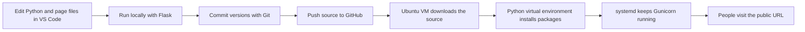

# Python Number Calculator

A beginner Python web application built with Flask. It adds, subtracts, or multiplies two numbers. Subtraction displays an error if Number A is smaller than Number B.

## 1. Open the project in VS Code

Download and unzip the project, then in VS Code choose **File → Open Folder** and select `number-calculator-python`. The main files are:

| File | What it does |
| --- | --- |
| `app.py` | Python code: receives the form, validates input, calculates, and returns a page. |
| `templates/index.html` | The page structure and input form. Flask fills in the result. |
| `static/style.css` | The page's appearance. |
| `requirements.txt` | The Python add-on packages the app needs. |
| `Dockerfile` | Instructions for packaging the app and its environment into a container image. |
| `compose.yaml` | A short command recipe for building and running the container locally. |
| `.gitignore` | Keeps local-only files such as the virtual environment out of Git. |

## 2. Run it locally (without Docker)

Install Python 3.10 or newer. In VS Code, choose **Terminal → New Terminal**. Make sure the terminal is in this project folder, then run these PowerShell commands:

```powershell
py -m venv .venv
.\.venv\Scripts\Activate.ps1
python -m pip install -r requirements.txt
python app.py
```

If PowerShell says running scripts is disabled when activating the virtual environment, use this command in that terminal and activate again:

```powershell
Set-ExecutionPolicy -Scope Process -ExecutionPolicy Bypass
```

Open `http://127.0.0.1:5000` in Chrome. Keep the terminal running while you use the app. Press **Ctrl+C** in the terminal to stop it.

The virtual environment (`.venv`) is a private place for this project's Python packages. `requirements.txt` is the list that lets another computer install the same kinds of packages.

## 3. Learn the Git and GitHub steps

Install Git, create a GitHub account, and open PowerShell in this folder. Run:

```powershell
git init
git add .
git commit -m "Create Python calculator"
git branch -M main
```

On GitHub, create a new empty repository named `number-calculator-python`. Then connect and upload it (replace `YOUR-USERNAME`):

```powershell
git remote add origin https://github.com/YOUR-USERNAME/number-calculator-python.git
git push -u origin main
```

Git stores a history of snapshots on your computer; GitHub stores a remote copy. For future changes, the everyday cycle is:

```powershell
git status
git add .
git commit -m "Describe the change"
git push
```

## 4. Optional: package and run it with Docker locally

Docker is included as an optional learning tool. It is not used for the Ubuntu EC2 deployment below. To try it on your own computer, install Docker Desktop, start it, then use the VS Code terminal in this folder:

```powershell
docker compose up --build
```

Open `http://localhost:8000` in Chrome. The first run builds an image from `Dockerfile`; the running container is the live app process. Stop it with **Ctrl+C**. To remove the stopped container, run:

```powershell
docker compose down
```

## 5. Understand the direct-Python deployment path



On the VM, Python runs directly on Ubuntu inside a virtual environment. Gunicorn serves the Flask app, and `systemd` starts and monitors Gunicorn. The included `Dockerfile` and `compose.yaml` are optional learning files and aren't used in this deployment path. Flask recommends using a production WSGI server such as Gunicorn instead of its built-in development server for a deployed app. [Flask deployment guide](https://flask.palletsprojects.com/en/stable/deploying/index.html)

## 6. Deploy directly to an Ubuntu EC2 virtual machine (no Docker)

These steps are for an EC2 instance created with an Ubuntu AMI. They install Python and Git on the VM, then install the app's Python packages into a virtual environment. On Ubuntu, the login name is `ubuntu` and packages are installed with `apt`.

### Prepare the EC2 instance

In the AWS console, confirm the instance is running and has a public IPv4 address. In its security group, allow:

- **SSH**, TCP port `22`, source **My IP** (so only your current internet address can log in).
- **Custom TCP**, port `8000`, source `0.0.0.0/0` (so browsers can reach this learning app).

Keep your downloaded `.pem` key private and out of GitHub. Check the current cost estimate and your account's free-usage offer before proceeding. A budget email is an alert, not a hard spending limit. This basic setup serves the app over HTTP and is for learning; use HTTPS and a domain before handling private information.

### Connect from Windows

In PowerShell or the VS Code terminal on your computer, replace the key filename and IP address:

```powershell
ssh -i "$HOME\Downloads\YOUR-KEY.pem" ubuntu@PUBLIC-IP
```

Type `yes` if SSH asks whether to trust the server the first time. These commands run on the Ubuntu server after you connect.

### Install Python and Git on Ubuntu

Connect over SSH, then install the Python virtual-environment tools and Git:

```bash
sudo apt update
sudo apt install -y python3 python3-venv python3-pip git
python3 --version
```

Ubuntu keeps system Python separate from packages installed with `pip`; the virtual environment below gives this project its own package area. Do not install the app packages globally with `sudo pip`. [Ubuntu Python guide](https://documentation.ubuntu.com/ubuntu-for-developers/tutorials/python-use/)

### Download the app and install its packages

Replace the GitHub address with your repository's HTTPS clone URL. This command stores the checkout in `/home/ubuntu/number-calculator-python`, which is the path used in the service setup below:

```bash
git clone https://github.com/YOUR-USERNAME/YOUR-REPOSITORY.git number-calculator-python
cd /home/ubuntu/number-calculator-python
python3 -m venv .venv
.venv/bin/python -m pip install --upgrade pip
.venv/bin/python -m pip install -r requirements.txt
```

The virtual environment is the project's private Python setup. The command installs Flask and Gunicorn from `requirements.txt` into `.venv`.

### Keep the app running with systemd

`systemd` is Ubuntu's service manager. It starts the app when the VM boots and restarts it if the process stops. Create a service file:

```bash
sudo tee /etc/systemd/system/number-calculator.service > /dev/null <<'EOF'
[Unit]
Description=Number Calculator Flask web app
After=network.target

[Service]
Type=simple
User=ubuntu
Group=ubuntu
WorkingDirectory=/home/ubuntu/number-calculator-python
Environment=PYTHONUNBUFFERED=1
ExecStart=/home/ubuntu/number-calculator-python/.venv/bin/gunicorn --workers 1 --bind 0.0.0.0:8000 --access-logfile - --error-logfile - app:app
Restart=always
RestartSec=3

[Install]
WantedBy=multi-user.target
EOF
sudo systemctl daemon-reload
sudo systemctl enable --now number-calculator
sudo systemctl status number-calculator --no-pager
```

In Chrome on your computer, open `http://PUBLIC-IP:8000`, replacing `PUBLIC-IP` with the EC2 instance's public IPv4 address. The security group must allow inbound TCP port `8000`.

If the page doesn't load, inspect the service status and recent logs:

```bash
sudo systemctl status number-calculator --no-pager
journalctl -u number-calculator -n 50 --no-pager
```

### Deploy a later GitHub change

After you commit and push changes to GitHub, connect to the VM and run these commands:

```bash
cd /home/ubuntu/number-calculator-python
git pull
.venv/bin/python -m pip install -r requirements.txt
sudo systemctl restart number-calculator
sudo systemctl status number-calculator --no-pager
```

To temporarily stop just the app while leaving the VM running, use `sudo systemctl stop number-calculator`. Start it again with `sudo systemctl start number-calculator`.

When you no longer need the VM, stop or terminate it in EC2. Stopping the VM takes the website offline; storage can still cost money, and a later start may assign a new public IP. Termination is for when you are done with that VM, so check its storage deletion settings first.

Reference: [Ubuntu's Python virtual-environment guide](https://documentation.ubuntu.com/ubuntu-for-developers/tutorials/python-use/), [Flask's Gunicorn guide](https://flask.palletsprojects.com/en/stable/deploying/gunicorn/), and [AWS's EC2 SSH guide](https://docs.aws.amazon.com/AWSEC2/latest/UserGuide/connect-linux-inst-ssh.html).

### DevOps topics, in learning order

1. **Application:** Python, Flask, HTML, CSS, and handling form input.
2. **Source control:** Git commits, branches, and GitHub remotes.
3. **Dependencies:** virtual environments and `requirements.txt`.
4. **Packaging (optional):** Docker images and containers. This EC2 path installs Python directly on Ubuntu.
5. **Automation (CI):** a GitHub Actions workflow can install dependencies and run checks whenever you push. This project is ready to add that next.
6. **Deployment (CD):** this first EC2 path downloads source from GitHub and runs Gunicorn as a `systemd` service. Later, automate it with GitHub Actions.
7. **Operations:** environment variables, logs, health checks, monitoring, and updating/restarting the deployed app.

This project includes the app, Git ignore rules, optional Docker packaging, and instructions for running the app directly on Ubuntu EC2 with a virtual environment and `systemd`.
